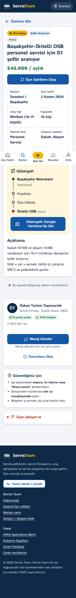
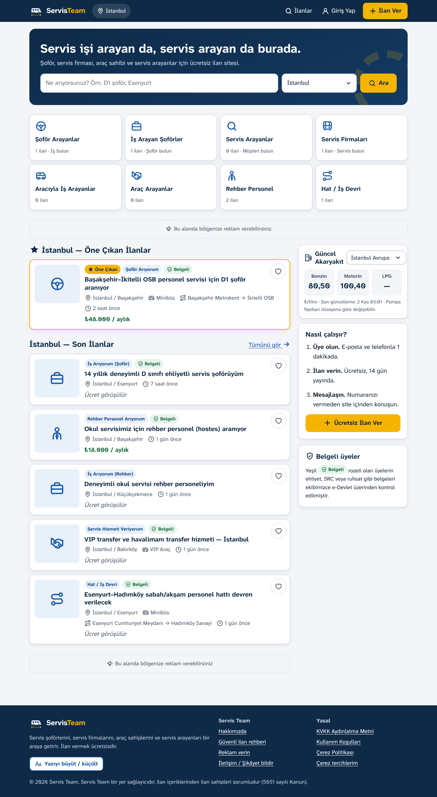

# Servis Team — servisteam.com

[](https://github.com/sinekvalesii/ServisTeam/actions/workflows/ci.yml)

<p align="center"> &nbsp; </p>

🌐 **Canlı önizleme:** https://sinekvalesii.github.io/ServisTeam/ — tarayıcıda çalışan tek dosyalık sürüm (veriler ziyaretçinin kendi cihazında saklanır).

🎬 **Tanıtım videosu (60 sn):** [docs/tanitim-videosu.mp4](docs/tanitim-videosu.mp4)

Servis şoförlerini, araç sahiplerini, servis firmalarını, kurumları ve servis arayan velileri buluşturan ilan platformu.
Orta yaş ve yaşlı kullanıcılar için tasarlandı: 18px taban yazı, yüksek kontrast, her ikonda yazı, en az 52px dokunma alanı, "Yazıyı büyüt" düğmesi, mobilde alt sekme çubuğu.

---

## 1. Neler var

| Alan | Özellik |
|---|---|
| **Üyelik** | E-posta + telefon zorunlu, e-posta ile 6 haneli kod doğrulama, şifre sıfırlama, 5 hatalı denemede 15 dk kilit |
| **Hesap türleri** | Şoför · Araç Sahibi · Servis Firması · Kurum/Şirket · Veli/Yolcu · Rehber Personel — 3 adımlı kurulum sihirbazı, türe özel alanlar (ehliyet sınıfı, SRC, deneyim, filo büyüklüğü, personel sayısı) |
| **Araçlar** | Tip, marka, model, yıl, kapasite, plaka **yalnızca il kodu**, özellikler (klima, USB, takip, engelli erişimi…) |
| **Belge doğrulama** | e-Devlet barkodu (önerilen) veya fotoğraf. Şifreli tutulur, karar anında **imha edilir**, en geç 7 günde otomatik silinir. Sonuç: "Belgeli" rozeti |
| **İlanlar** | 9 ilan türü, bireysel/firma, başlık-açıklama, hizmet türü, araç tipi, kapasite, vardiya, il/ilçe (81 il, 973 ilçe), **güzergah + ara duraklar → Google Haritalar**, ücret (gizlenebilir), 6 fotoğraf (konum metadata'sı silinir), "telefonumu göster" açık rızası |
| **14 gün kuralı** | İlan 14 gün sonra otomatik pasife düşer, "İlanlarım > Süresi dolan" sekmesinde görünür, tek tıkla yeniden yayın |
| **Arama** | Kelime (Türkçe tam metin), il, ilçe, ilan türü, araç tipi, hizmet türü, bireysel/firma, belgeli, ücreti belli, sıralama |
| **Konum** | İlk girişte "Bölgenizdeki ilanları gösterelim mi?" — il **telefonda hesaplanır, koordinat sunucuya gitmez** |
| **Favoriler / Mesajlaşma** | Site içi mesajlaşma (5 sn'de bir yenilenir), okunmamış sayacı, engelleme, şikâyet, "kapora/IBAN" içeren mesajlara otomatik uyarı |
| **Akaryakıt** | İstanbul Avrupa/Anadolu, Ankara, İzmir, Bursa, Türkiye ort. — 2 saatte bir otomatik + admin manuel giriş |
| **Gelir** | Bölge vitrini (admin manuel öne çıkarır), il hedefli doğrudan reklam alanları, Google AdSense (yalnızca çerez onayıyla) |
| **Admin paneli** | Özet, ilan moderasyonu, kullanıcı askıya alma/rol, şikâyetler, belge kuyruğu, yakıt, reklamlar, yasal sayfalar, ayarlar (ön onay modu, duyuru, bakım modu), işlem kayıtları, 5651 trafik dışa aktarımı |
| **KVKK** | Aydınlatma metni, ayrı açık rızalar, verilerimi indir (JSON), hesabımı sil, doğrulanmamış hesaplar 3 günde silinir, yöneticiler mesajları **yalnızca şikâyet edilirse** görür ve her görüntüleme kayda geçer |

## 2. Teknik yapı

- **Node.js 22 + Express + EJS** (sunucu taraflı sayfa: eski telefonlarda bile hızlı), **PostgreSQL 16**
- Güvenlik: Helmet + sıkı CSP, CSRF token, bcrypt (12), oturum yenileme, hız sınırları, dosya imzası kontrolü, AES-256-GCM, parametreli SQL, `npm audit` temiz
- Yazı tipi: Atkinson Hyperlegible Next (az gören okurlar için tasarlanmış) — **kendi sunucumuzdan**, Google Fonts'a IP gönderilmez
- Testler: `npm test` (kayıt → doğrulama → ilan → mesaj → süre dolumu → belge imhası → hesap silme)

## 3. Yayına alma (Türkiye'de VPS)

**Gerekli:** Ubuntu 22.04/24.04 VPS (en az 2 GB RAM), servisteam.com alan adı.

```bash
# 1) Sunucuya Docker kurun
curl -fsSL https://get.docker.com | sh

# 2) Projeyi sunucuya kopyalayın ve klasöre girin
cd servisteam
cp .env.example .env
nano .env          # SESSION_SECRET, DATA_ENCRYPTION_KEY, POSTGRES_PASSWORD, SMTP ve şirket bilgilerini doldurun
#   Anahtar üretmek için:  openssl rand -hex 32

# 3) Alan adının A kaydını sunucu IP'sine yönlendirin (servisteam.com ve www)

# 4) Başlatın (HTTPS sertifikası otomatik alınır)
docker compose up -d --build

# 5) Admin hesabınızı oluşturun (şifre sorulur)
docker compose exec app node src/db/create-admin.js eposta@adresiniz.com 05XXXXXXXXX "Ad Soyad"
```

Admin paneli: `https://servisteam.com/yonetim`

**Güncelleme:** yeni dosyaları kopyalayıp `docker compose up -d --build`.
**Yedek:** `./backups` klasörüne günlük alınır. Haftada bir sunucu dışına kopyalayın.
**Önemli:** `DATA_ENCRYPTION_KEY` değerini kaybetmeyin ve değiştirmeyin.

### Yerel geliştirme
```bash
npm install
npm run migrate
npm run demo-seed     # örnek ilanlar (demo şifresi: Demo12345)
npm run dev           # http://localhost:3000 — doğrulama kodları terminale yazılır
```

## 4. Yayından önce yapılacaklar (sizin tarafınızda)

Kod tarafı hazır; aşağıdakiler hukuki/idari adımlar. **Yasal metinler taslaktır, bir avukata kontrol ettirin.**

1. **Şirket** — Reklam ve öne çıkarma geliri için şahıs şirketi yeterli. Bilgileri `.env`'e girin (yasal metinlere otomatik yazılır).
2. **ETBİS kaydı** — 6563 sayılı Kanun kapsamında aracı hizmet sağlayıcılar için; mali müşavirinizle teyit edin.
3. **5651 / BTK** — Site "yer sağlayıcı" konumunda. Trafik kayıtları (IP + port + zaman) 2 yıl tutuluyor. BTK yer sağlayıcı bildirim yükümlülüğünü avukatınızla teyit edin.
4. **KVKK** — VERBİS kaydı belirli çalışan/ciro eşiklerinin altında zorunlu değildir; güncel eşiği kontrol edin. Kişisel veri işleme envanteri hazırlayın.
5. **E-posta (SMTP)** — Doğrulama kodları için zorunlu. Alan adınıza bağlı kurumsal e-posta + SPF/DKIM kayıtları (kodların spam'e düşmemesi için).
6. **İYS** — Kampanya e-postası/SMS'i göndermeye başlamadan önce İleti Yönetim Sistemi kaydı gerekir. (Doğrulama kodları ticari ileti değildir.)
7. **Google AdSense** — Site yayına girip ilanlar oluştuktan sonra başvurun. Onay gelince `ADSENSE_CLIENT` ve admin > Reklamlar'dan slot numaralarını girin. `ads.txt` otomatik üretilir.
8. **Marka** — "Servis Team" adı ve logosu için TÜRKPATENT tescil başvurusu önerilir.
9. **Admin güvenliği** — Admin şifresi en az 14 karakter olsun; admin e-postasında iki adımlı doğrulama açın.

## 5. Bilinmesi gerekenler

- **Akaryakıt API'si** resmî değil, ücretsiz ve garantisiz. Yanıtında sütunlar bir kaydırılmış geliyor (benzin fiyatı anahtar alanında); ayrıştırıcı bunu ve düzeltilmiş biçimi destekliyor. LPG vermiyor → admin panelinden manuel girin. API düşerse son fiyatlar gösterilmeye devam eder.
- **SMS doğrulama** kodu hazır (Netgsm) ama kapalı. Açmak için `.env`'de `SMS_PROVIDER=netgsm` ve Netgsm bilgileri.
- **Online ödeme** bilinçli olarak yok; öne çıkarma admin'den manuel yapılır ve ücret alanına girilen tutar kayda geçer.
- **Adli sicil kaydı** özel nitelikli kişisel veri olduğu için platformda istenmez.

## 6. Tek dosyalık sürüm (önizleme)

`index.html`, sunucusuz çalışan, tek dosyalık sürümdür: tüm ekranlar, örnek ilanlar ve admin paneli içindedir; veriler ziyaretçinin tarayıcısında (localStorage) tutulur. **Tanıtım ve tasarım onayı içindir**, gerçek kullanıcılar için sunucu sürümü kullanılmalıdır (ilanlar cihazlar arasında paylaşılmaz, e-posta gönderilmez).

Yeniden derlemek için:
```bash
node standalone/build.js "ADMIN-SIFRESI"   # → standalone/dist/servisteam.html
cp standalone/dist/servisteam.html index.html
```

## 7. Dosya yapısı

```
src/server.js          uygulama, güvenlik başlıkları, oturum
src/routes/            public, auth, listings, account, messages, api, admin
src/lib/               auth, security (CSRF/limit/5651), crypto, otp, fuel, ads, uploads, geo
src/data/              taxonomy (hesap/ilan/araç türleri), iller.json (81 il, 973 ilçe)
src/db/                schema.sql, migrate, pages (yasal metinler), create-admin, demo-seed
src/jobs.js            14 gün kuralı, belge imhası, yakıt yenileme, saklama süreleri
views/                 EJS şablonları    public/  css, js, logo, fontlar
deploy/Caddyfile       HTTPS + 5651 port başlığı
```
